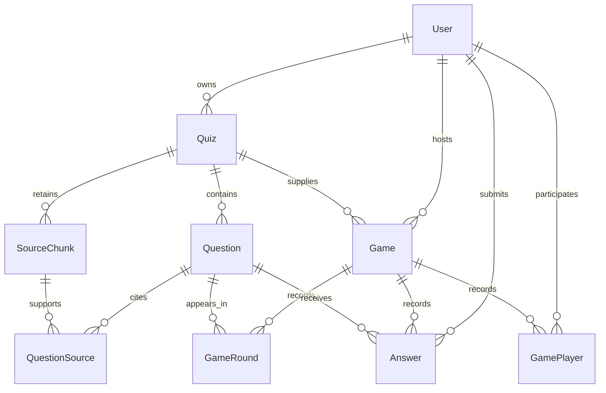

# Cortex data persistence

This describes the repository schema and code paths as inspected, not the state of a particular deployed database. The source of truth for the relational shape is [`backend/prisma/schema.prisma`](../backend/prisma/schema.prisma); the SQL history is in [`backend/prisma/migrations/`](../backend/prisma/migrations/). There is no separate SQL repository layer or raw application SQL query in `backend/src`: application reads and writes use the shared Prisma client in [`backend/src/lib/prisma.ts`](../backend/src/lib/prisma.ts).

## Database overview

PostgreSQL owns durable `User`, `Quiz`, `Question`, `Game`, `GamePlayer`, and `Answer` rows. Clerk owns external identity; `users.clerk_user_id` maps it to the internal UUID used in foreign keys. Redis owns waiting rooms, active rounds, live scores, answer submissions before completion, public room discovery, generation work/status, and BullMQ jobs. A waiting room exists only in Redis until `startGame` creates the Postgres `games` row with the same UUID. Finished game details are written to Postgres by the game-finish worker. See [`backend/src/services/lobby.service.ts`](../backend/src/services/lobby.service.ts), [`backend/src/services/gameCompletion.service.ts`](../backend/src/services/gameCompletion.service.ts), and [`backend/src/lib/queue.ts`](../backend/src/lib/queue.ts).

Runtime Prisma connects through `DATABASE_URL`; migration tooling connects through `DIRECT_URL` in [`backend/prisma.config.ts`](../backend/prisma.config.ts). Redis uses `REDIS_URL` in [`backend/src/lib/redis.ts`](../backend/src/lib/redis.ts). Compose runs Redis with AOF and a volume, but includes no Postgres service; Redis persistence on disk does not make live state durable product history ([`docker-compose.yml`](../docker-compose.yml)).

## Schema inventory

Names below are Prisma fields; `@map` converts camel case fields to snake case SQL columns, and each model maps to the plural table named in parentheses. `String @db.Uuid` is a PostgreSQL UUID, `DateTime` is `TIMESTAMP(3)` in the migrations, `Int` is `INTEGER`, and `Json` is `JSONB` in the migration SQL. `?` means nullable. Every `id` below is the primary key. See the [schema](../backend/prisma/schema.prisma) and the [migration files](../backend/prisma/migrations/).

| Model (table) | Scalar fields and database types | Keys, relationships, and constraints |
| --- | --- | --- |
| `User` (`users`) | `id` UUID (generated UUID); `clerkUserId` text; `username` varchar(20); `email` varchar(255); `rating` integer default 1200; `gamesPlayed` integer default 0; `wins` integer default 0; `createdAt` timestamp default now; `updatedAt` timestamp managed by Prisma `@updatedAt`; `lastActive` timestamp default now | Unique `clerkUserId`, `username`, `email`. Referenced by quizzes, hosted games, game players, answers. |
| `Quiz` (`quizzes`) | `id` UUID (generated); `ownerId` UUID; `title` varchar(255); `sourceType` enum `pdf`/`text`; `status` enum `processing`/`ready`/`failed`, default `ready`; `questionCount` integer; `errorMessage` text nullable; `createdAt` timestamp default now | `ownerId` → `User.id` (restrict delete); index on `ownerId` and `status`. Referenced by questions and games. |
| `Question` (`questions`) | `id` UUID (generated); `quizId` UUID; `type` enum `MCQ`/`TRUE_FALSE`/`FILL_BLANK`; `question` text mapped to `question_text`; `content` JSONB; `explanation` text; `position` integer; `createdAt` timestamp default now | `quizId` → `Quiz.id` (cascade delete); unique (`quizId`, `position`); index on `quizId`. Referenced by answers. |
| `SourceChunk` (`source_chunks`) | `id` UUID; `quizId` UUID; stable `chunkId` varchar(32); extracted `text` | `quizId` → `Quiz.id` (cascade delete); unique (`quizId`, `chunkId`). Only chunks cited by accepted questions are stored. |
| `QuestionSource` (`question_sources`) | `id` UUID; `questionId` UUID; `sourceChunkId` UUID; verbatim `quote` text | Both foreign keys cascade on delete; unique (`questionId`, `sourceChunkId`, `quote`). |
| `Game` (`games`) | `id` UUID (generated by default; start passes the Redis UUID explicitly); `roomCode` varchar(6); `quizId` UUID; `hostId` UUID; `status` enum `waiting`/`playing`/`finished`/`cancelled`, default `waiting`; `rounds` integer default 10; `createdAt` timestamp default now; `finishedAt` timestamp nullable | Unique `roomCode`; `quizId` → `Quiz.id`, `hostId` → `User.id` (both restrict delete); indexes on `quizId`, `hostId`, `createdAt`. Referenced by game players and answers. |
| `GameRound` (`game_rounds`) | `gameId` UUID; `roundNumber` integer; `questionId` UUID | Compound primary key (`gameId`, `roundNumber`); `gameId` → `Game.id` (cascade delete), `questionId` → `Question.id` (restrict delete). Stores played order, including rounds with no answer. |
| `GamePlayer` (`game_players`) | `id` UUID (generated); `gameId` UUID; `userId` UUID; `score` integer default 0; `rank` integer nullable; `ratingChange` integer nullable; `abandoned` boolean default false; `createdAt` timestamp default now | `gameId` → `Game.id` (cascade delete); `userId` → `User.id` (restrict delete); unique (`gameId`, `userId`); index on `userId`. |
| `Answer` (`answers`) | `id` UUID (generated); `gameId` UUID; `userId` UUID; `questionId` UUID; `response` JSONB; `correct` boolean; `points` integer; `responseTimeMs` integer; `createdAt` timestamp default now | `gameId` → `Game.id` (cascade delete); `userId` → `User.id`, `questionId` → `Question.id` (both restrict delete); unique (`gameId`, `userId`, `questionId`); indexes on `userId`, `questionId`. |

Foreign keys not explicitly marked cascade use the migration's `ON DELETE RESTRICT`; all listed foreign keys use `ON UPDATE CASCADE`. There is **no** `Game.winnerId` relation in the current schema. `Answer` has separate references to game, user, and question; no database constraint asserts that its question belongs to the game's quiz or that its user has a `GamePlayer` row. The database does not enforce the type-specific JSONB content shape or nonnegative scores/counts, or correspondence between `Quiz.questionCount` and its child rows; those depend on application logic ([schema](../backend/prisma/schema.prisma), [`backend/src/schemas/quiz.ts`](../backend/src/schemas/quiz.ts), [`backend/src/services/round.service.ts`](../backend/src/services/round.service.ts)).

## Entity relationships

The diagram shows only declared Prisma foreign keys. `GamePlayer` and `Answer` do not have a direct relation to each other ([schema](../backend/prisma/schema.prisma)).

## Data ownership and lifecycle

| Data | Create / update / delete | Read and lifecycle |
| --- | --- | --- |
| User | Verified Clerk `user.created` upserts; `user.updated` changes email/username; `user.deleted` attempts `deleteMany` ([`backend/src/webhooks/clerk.ts`](../backend/src/webhooks/clerk.ts)). Authenticated profile update changes username ([`backend/src/controllers/user.controller.ts`](../backend/src/controllers/user.controller.ts)). | REST and socket auth resolve Clerk ID to internal `users.id`; game/quiz controllers do the same ([`backend/src/controllers/game.controller.ts`](../backend/src/controllers/game.controller.ts), [`backend/src/controllers/quiz.controller.ts`](../backend/src/controllers/quiz.controller.ts), [`backend/src/socket/auth.ts`](../backend/src/socket/auth.ts)). Referenced rows can prevent user deletion. |
| Quiz, Question, and sources | [`backend/src/services/quiz/pipeline.ts`](../backend/src/services/quiz/pipeline.ts) validates a complete generated set and verifies each source ID and verbatim quote against its packed chunk. [`backend/src/services/quiz/persist.service.ts`](../backend/src/services/quiz/persist.service.ts) creates a `ready` quiz, questions, cited chunks, and quote relations in one transaction. No application quiz/question update or delete path was found. | Owner-scoped quiz detail returns metadata only; room creation checks owner, ready status, and count. At game start [`backend/src/services/quizCache.service.ts`](../backend/src/services/quizCache.service.ts) loads questions for server-side play. Source files and uncited extracted text are not stored in Postgres; Redis holds generation work chunks temporarily until successful persistence. |
| Game | [`backend/src/services/game.service.ts`](../backend/src/services/game.service.ts) creates a Redis-only waiting room. [`backend/src/services/lobby.service.ts`](../backend/src/services/lobby.service.ts) pins a quiz snapshot and per-game question order, upserts the `playing` Postgres row, then atomically activates Redis. It removes the row if Redis confirms the room is still waiting after a failed activation. [`backend/src/services/gameCompletion.persistence.ts`](../backend/src/services/gameCompletion.persistence.ts) marks it finished. | Before start, Redis owns lobby status and roster. During play Redis owns current round, order, players and scores; Postgres has the game header. After successful completion Postgres has `finishedAt` and results. No game history query or general application game deletion path was found. |
| GamePlayer, Answer, and GameRound | [`backend/src/services/gameCompletion.persistence.ts`](../backend/src/services/gameCompletion.persistence.ts) upserts all three at completion using the final leaderboard, submissions, and Redis question order. | [`backend/src/services/answer.service.ts`](../backend/src/services/answer.service.ts) reads/writes live submissions in Redis; [`backend/src/services/gameCompletion.service.ts`](../backend/src/services/gameCompletion.service.ts) gathers submissions and every played question ID. Missing answers are filtered before `Answer` insertion but their rounds remain in `GameRound`. The finished-game review reads these durable records for persisted members. |

Generation has a Redis job status and work payload, each with a one-hour TTL. On success the worker stores the ready quiz and questions in Postgres, marks the Redis job ready with `quizId`, and attaches it to a waiting room through a BullMQ job when applicable. Failure remains a Redis job/room status; normal generation does not insert `processing` or `failed` quiz rows despite those enum values existing in the schema. The work payload retains a `persistedQuizId` checkpoint to avoid a duplicate insert on a worker retry after persistence ([`backend/src/services/quiz/persist.service.ts`](../backend/src/services/quiz/persist.service.ts), [`backend/src/services/quiz/pipeline.ts`](../backend/src/services/quiz/pipeline.ts), [`backend/src/workers/waitingRoomQuiz.worker.ts`](../backend/src/workers/waitingRoomQuiz.worker.ts)).

Generation labels chunks before packing, requires one or more references per question, and rejects unknown IDs or quotes absent from the referenced chunk through the existing batch retry path. This verifies that excerpts came from the upload; it does not prove the answer or explanation is semantically correct. Only cited chunks survive successful persistence. Existing quizzes can have explanations with no source relations.

At the last round, [`backend/src/services/roundEnd.service.ts`](../backend/src/services/roundEnd.service.ts) queues a game-finish job. Its worker gathers the Redis roster/submissions/order, upserts ranked players, submitted answers, and every played round, updates `games.status`/`finishedAt` in one Postgres transaction, then marks the Redis hash finished and broadcasts results ([`backend/src/workers/gameFinish.worker.ts`](../backend/src/workers/gameFinish.worker.ts), [`backend/src/services/gameCompletion.service.ts`](../backend/src/services/gameCompletion.service.ts)). Tied first place is represented by multiple rank-1 rows; there is no winner column or rating update ([`backend/src/services/gameCompletion.helpers.ts`](../backend/src/services/gameCompletion.helpers.ts)).

## Redis storage and its boundary with Postgres

Exact application key builders are in [`backend/src/lib/redisKeys.ts`](../backend/src/lib/redisKeys.ts); the queue names and options are in [`backend/src/lib/queue.ts`](../backend/src/lib/queue.ts). BullMQ also creates its own Redis keys; application code does not define those key strings.

| Key | Value and use | Observed lifetime |
| --- | --- | --- |
| `room-code:<roomCode>` | String game UUID; collision-resistant reservation via `SET EX NX` ([`backend/src/lib/roomCode.ts`](../backend/src/lib/roomCode.ts)). | One hour at reservation; refreshed to two hours on start; removed on empty lobby. |
| `game:<gameId>` | Hash: room metadata, host, quiz generation status, JSON players, public flag, and status; during play also shuffled question order, pinned quiz version, current round/index, last scored round, and resumable public phase/payload/version. | One hour at room creation; refreshed to two hours on start. |
| `public-waiting` | Sorted set of public waiting game UUIDs scored by creation time. | No TTL; removed on start/empty leave and stale entries pruned during listing ([`backend/src/services/publicWaitingFeed.service.ts`](../backend/src/services/publicWaitingFeed.service.ts)). |
| `game:<gameId>:round` | Hash with current question, type, private JSON content, explanation, start time, submission count. | Replaced by the next round's atomic `HSET`; two-hour TTL set on each round. |
| `quiz:<quizId>:questions` | Shared JSON snapshot of all validated quiz questions, including answer keys and a content hash. Active games pin the hash; a changed reload is rejected for those games. | Three-hour TTL refreshed on reads. A miss reloads all questions from Postgres in one query. Completion does not delete it. |
| `game:<gameId>:start-lock` | Tokenized `SET NX` claim for concurrent start requests. | 120-second TTL; released by its owner after start or failure. |
| `game:<gameId>:round:<n>:correctCount` | Integer correct-answer placement counter. | No TTL is set by the current answer code. |
| `game:<gameId>:round:<n>:submissions:<playerId>` | JSON per-player submission and duplicate guard. | No TTL is set by the current answer code. |
| `game:<gameId>:round:<n>:ended` | String `1`, round-end winner guard. | `SET EX 30 NX` gives a 30-second TTL. |
| `quiz-gen:job:<jobId>` / `quiz-gen:work:<jobId>` | JSON pollable job state / source chunks and worker checkpoint. | Each write sets a one-hour TTL; work deleted after success. |
| `quiz-gen:inflight:<ownerId>` | Short duplicate-dispatch guard. | `SET EX 15 NX`; explicitly deleted in `finally`. |

Room/player IDs in Redis are internal Postgres `users.id`; the game's UUID is shared with Postgres only after start. The public socket question omits answer keys and `explanation`, while the server-side quiz cache and current round retain them ([`backend/src/services/gamePlay.helpers.ts`](../backend/src/services/gamePlay.helpers.ts), [`backend/src/services/round.service.ts`](../backend/src/services/round.service.ts)).

## Transactions and consistency

- Quiz, questions, cited chunks, and their verified quote relations use one `prisma.$transaction`; a failed child insert rolls back the quiz ([`backend/src/services/quiz/persist.service.ts`](../backend/src/services/quiz/persist.service.ts)).
- Game completion uses `prisma.$transaction` around `GamePlayer`, `Answer`, and `GameRound` upserts plus the final `Game` update. Unique compound keys make the upserts repeatable if the worker retries. The finish queue config has five attempts with exponential backoff; a failed existing finish job can be removed and requeued ([`backend/src/services/gameCompletion.persistence.ts`](../backend/src/services/gameCompletion.persistence.ts), [`backend/src/lib/queue.ts`](../backend/src/lib/queue.ts), [`backend/src/services/gameFinish.queue.ts`](../backend/src/services/gameFinish.queue.ts)).
- Lobby join, readiness, leave/host promotion, waiting quiz status, game activation, and round advancement use Redis Lua scripts. Room creation uses `MULTI`; score application uses `WATCH`/`MULTI` and a per-round marker to avoid duplicate payouts. Submission Lua atomically rejects duplicates, checks correctness, increments placement/submission count and writes a base record; a later separate `SET` completes its scoring fields. A `SET NX` key selects one round-end path; phase version and payload are published in one Lua operation ([`backend/src/services/lobby.service.ts`](../backend/src/services/lobby.service.ts), [`backend/src/services/waitingQuiz.service.ts`](../backend/src/services/waitingQuiz.service.ts), [`backend/src/services/roundEnd.service.ts`](../backend/src/services/roundEnd.service.ts), [`backend/src/services/answer.service.ts`](../backend/src/services/answer.service.ts), [`backend/src/services/gameResume.service.ts`](../backend/src/services/gameResume.service.ts)).
- There is no transaction spanning Redis and Postgres. `startGame` claims one start per room, uses a stable-ID Postgres upsert for retry, and activates Redis with a status compare. If activation fails while Redis confirms the room is still waiting, it removes the Postgres row; an unreachable Redis leaves the row for retry ([`backend/src/services/lobby.service.ts`](../backend/src/services/lobby.service.ts)). Completion commits Postgres before setting Redis status and broadcasting ([`backend/src/services/gameCompletion.service.ts`](../backend/src/services/gameCompletion.service.ts)).

## Migrations and safe change procedure

The additive `20261018000000_source_grounded_review` migration adds source chunks, question quotes, and played-round order without changing existing quiz/question rows. Existing quizzes may have explanations but no sources, and existing finished games have no reliable order for unanswered rounds. See the SQL under [`backend/prisma/migrations/`](../backend/prisma/migrations/).

The documented local command is `cd backend` then `npx prisma migrate dev` ([`README.md`](../README.md), [`CLAUDE.md`](../CLAUDE.md)). `npm run build` runs `prisma generate`, not migrations ([`backend/package.json`](../backend/package.json)). No production migration/deploy script or automatic migration at backend startup appears in this repository. For a future schema change, inspect existing data and the generated SQL, make and review a new migration in development, back up the target database, and apply a reviewed migration using the deployment procedure for that environment. Keep `DIRECT_URL` and `DATABASE_URL` pointed at the intended database. Do not rewrite applied migrations or edit the generated Prisma client.

The quiz conversion migration adds required `answers.question_id`, `answers.answer_index`, and `games.quiz_id` without defaults/backfill, and drops countries and legacy answer/game columns. On a populated legacy database it can fail or destroy the old information; inspect and plan a data migration before applying it there ([`backend/prisma/migrations/20260806000000_quizzes_questions/migration.sql`](../backend/prisma/migrations/20260806000000_quizzes_questions/migration.sql)). The configured seed command points to `scripts/seedCountries.ts`, and `seed:quiz` points to `scripts/seedSampleQuiz.ts`, but neither file is present in this checkout ([`backend/prisma.config.ts`](../backend/prisma.config.ts), [`backend/package.json`](../backend/package.json)).

## Indexes and performance

Primary keys and the unique keys in the inventory are indexed. Explicit nonunique indexes are: `quizzes(owner_id)`, `quizzes(status)`, `questions(quiz_id)`, `games(host_id)`, `games(quiz_id)`, `games(created_at)`, `game_players(user_id)`, `answers(user_id)`, and `answers(question_id)` ([schema](../backend/prisma/schema.prisma), [migration SQL](../backend/prisma/migrations/)). The unique (`quiz_id`, `position`) index supports the one-query cache load; the unique answer/player compound indexes support completion upserts. `getAllQuizzes` filters by owner and status and sorts by `createdAt`, but there is no combined `(owner_id, status, created_at)` index or pagination in that query ([`backend/src/services/quiz/persist.service.ts`](../backend/src/services/quiz/persist.service.ts)). `listPublicWaitingRooms` iterates all indexed IDs and reads each hash serially ([`backend/src/services/publicWaitingFeed.service.ts`](../backend/src/services/publicWaitingFeed.service.ts)). These are code-supported scaling concerns, not measured bottlenecks.

## Integrity rules and known limitations

- Preserve the Clerk-ID/internal-UUID boundary and owner checks. Keep the live question answer key server-side, generation validation for all three type-specific content shapes, and exact requested question count before persistence ([`backend/src/socket/auth.ts`](../backend/src/socket/auth.ts), [`backend/src/services/gamePlay.helpers.ts`](../backend/src/services/gamePlay.helpers.ts), [`backend/src/schemas/quiz.ts`](../backend/src/schemas/quiz.ts), [`backend/src/services/quiz/pipeline.ts`](../backend/src/services/quiz/pipeline.ts)).
- Preserve compound uniqueness, foreign-key delete behavior, and the atomic completion transaction. `ratingChange`, `abandoned`, `User.rating`, `gamesPlayed`, and `wins` are schema fields but the inspected completion path does not update them ([schema](../backend/prisma/schema.prisma), [`backend/src/services/gameCompletion.persistence.ts`](../backend/src/services/gameCompletion.persistence.ts)).
- The current round key expires after two hours, but `CORRECT_COUNT_KEY` and `SUBMISSION_KEY` still have no explicit TTL. They can outlive the game hash, including after successful completion ([`backend/src/lib/redisKeys.ts`](../backend/src/lib/redisKeys.ts), [`backend/src/services/round.service.ts`](../backend/src/services/round.service.ts), [`backend/src/services/answer.service.ts`](../backend/src/services/answer.service.ts)).
- The submission Lua writes a base record, then a separate command writes correctness/points. A failure between those writes leaves a duplicate guard and incomplete record; score calculation and completion read the stored record ([`backend/src/services/answer.service.ts`](../backend/src/services/answer.service.ts), [`backend/src/services/gameCompletion.service.ts`](../backend/src/services/gameCompletion.service.ts)).
- The round-end `SET NX` guard expires after 30 seconds. If processing fails after claiming it, a retry during that window returns without finishing; after expiry, score application is guarded by `lastScoredRound`, but publication can be retried. The three-second next-round transition is an in-process `setTimeout`, so a restart during that gap has no durable scheduling record ([`backend/src/services/roundEnd.service.ts`](../backend/src/services/roundEnd.service.ts)).
- Completion depends on live Redis roster and submission keys. The game hash expires two hours after start and is not refreshed during play. Missing Redis state makes finalization fail even if a Postgres game row exists; no recovery from Postgres alone is implemented ([`backend/src/services/lobby.service.ts`](../backend/src/services/lobby.service.ts), [`backend/src/services/gameCompletion.service.ts`](../backend/src/services/gameCompletion.service.ts)).
- The generation checkpoint is written to Redis *after* the Postgres quiz insert. A process failure in that gap can cause a retry to insert a second ready quiz; the checkpoint reduces but does not eliminate that cross-store window ([`backend/src/services/quiz/pipeline.ts`](../backend/src/services/quiz/pipeline.ts), [`backend/src/services/quiz/persist.service.ts`](../backend/src/services/quiz/persist.service.ts)).
- `Quiz.status` permits processing/failed values, but normal generation stores only ready rows. The historical migration retains those fields, and `getAllQuizzes` filters to ready quizzes; do not infer that Postgres tracks failed jobs ([`backend/src/services/quiz/persist.service.ts`](../backend/src/services/quiz/persist.service.ts)).

**Question content migration:** Apply `20261017000000_unified_question_content` only after active quiz rooms have drained. It deletes answers, game players, games, questions, and quizzes in foreign-key order; user/account rows remain. The migration is intentionally irreversible for old quiz and result data. Redis room, round, and quiz snapshot keys expire independently and are not part of the SQL transaction. No migration was run against a live database as part of this code change.
