# Cortex real-time multiplayer implementation

This document describes the implementation in the repository, not a proposed protocol. Paths are relative to the repository root. **Enforced** means a check is present in the cited server code; **missing guarantee** means the code does not enforce the stated property. This is a source review; it does not claim a live multiplayer run was performed.

## 1. Multiplayer overview

A host creates a waiting room through authenticated HTTP, either with an owned ready quiz or with an upload to generate one. The room code maps to a Redis game hash. Authenticated Socket.io clients join `game:<gameId>` using `join_game`; the server sends a full `joined` snapshot and broadcasts later lobby changes. The host UI shows Start when everyone is ready and the quiz is ready. Once play begins, the server selects questions, grades answers, schedules deadlines, and broadcasts phases. The browser renders those events through Zustand stores. See `backend/src/controllers/game.controller.ts`, `backend/src/services/game.service.ts`, `backend/src/socket/lobbyHandler.ts`, `frontend/src/hooks/useLobbySocket.ts`, and `frontend/src/hooks/useGameSocket.ts`.

The Socket.io server shares the Express HTTP server. `backend/src/index.ts` calls `attachSocket`, then starts the round-end, game-finish, quiz-generate, and waiting-room-quiz BullMQ workers in that same process. `backend/src/socket/index.ts` authenticates every connection and registers lobby, game, and public-room feed handlers. No cross-instance Socket.io adapter is configured there.

## 2. Game lifecycle and phases

```mermaid
stateDiagram-v2
  [*] --> Waiting: HTTP create waiting room
  Waiting --> Waiting: join / ready / leave / quiz status
  Waiting --> Countdown: start_game; ready quiz and all players ready
  Waiting --> [*]: last player leaves or Redis TTL expires
  Countdown --> Question: 3-second callback publishes first question
  Question --> RoundResults: round deadline or all players answered
  RoundResults --> Question: 4.5-second callback for next round
  RoundResults --> Finished: last round; delayed finish job persists and publishes result
  Finished --> [*]: live Redis state eventually expires
```

There are two related state models. The Redis `game:<id>.status` is `waiting`, `playing`, or `finished` in the implemented path. `cancelled` exists in the TypeScript/Prisma types, but no cancellation transition is visible in these services (`backend/src/types/room.types.ts`, `backend/prisma/schema.prisma`). During `playing`, `publicPhase` is `countdown`, `question`, or `round_results`; completion publishes `game_finished` (`backend/src/services/gameResume.service.ts`). The frontend also has a local `idle` view (`frontend/src/stores/gameStore.ts`).



| Phase | Entry and allowed transition | Code evidence |
| --- | --- | --- |
| Waiting, quiz processing/ready/failed | HTTP room creation; a saved quiz makes it ready immediately, while an upload is generated asynchronously. Authenticated users may join by code; members may toggle ready or leave. Host-only HTTP upload/fail operations require a waiting room. Start requires at least two players, every player ready, and a ready quiz. | `backend/src/services/game.service.ts`, `waitingQuiz.service.ts`, `lobby.service.ts`; `backend/src/controllers/game.controller.ts` |
| Countdown | `start_game` creates a Postgres `Game`, flips Redis to `playing`, publishes `game_started` with a three-second countdown, and begins loading the first round. | `backend/src/socket/lobbyHandler.ts`, `backend/src/services/lobby.service.ts` |
| Question | The server stores a selected question, publishes public fields in `new_question`, and schedules a 30-second round-end job. Members may submit once for the current question before the server deadline. | `backend/src/services/round.service.ts`, `gamePlay.helpers.ts`, `answer.service.ts`, `roundEnd.service.ts` |
| Submitted question | The browser locks its chosen option immediately and keeps the question visible. Private `answer_result` adds inline feedback; a rejected or timed-out acknowledgement triggers snapshot reconciliation. Redis `publicPhase` remains `question` until round end. Other clients see `answer_submitted`. | `frontend/src/hooks/useGameSocket.ts`, `frontend/src/stores/gameStore.ts`, `backend/src/socket/gameHandler.ts` |
| Round results | The timer worker or last submission claims the end guard and keeps the question phase until the latest accepted answer has had two seconds of private feedback. It then scores submissions, publishes previous/final standings and an absolute reveal end time, and starts the next round after 4.5 seconds or enqueues finish with the same delay. | `backend/src/services/roundEnd.service.ts` |
| Finished | The game-finish worker reads live Redis scores/submissions, commits final rows in Postgres, marks Redis finished, and publishes `game_finished`. | `backend/src/services/gameCompletion.service.ts`, `gameCompletion.persistence.ts` |

The three-second countdown and 4.5-second between-round wait use Node `setTimeout` callbacks. They are not persisted as delayed BullMQ jobs. Final completion uses a delayed BullMQ job. The first question's clock is reset with `beginRoundClock` immediately before its broadcast; later rounds use the `startedAt` written by `startRound` (`backend/src/socket/lobbyHandler.ts`, `backend/src/services/round.service.ts`, `backend/src/services/roundEnd.service.ts`).

## 3. Socket.io contract

All client connections must supply a Clerk token in the Socket.io handshake. `backend/src/socket/auth.ts` verifies it, looks up the corresponding Postgres user, and stores `socket.data.userId` as the internal `users.id`. The browser's singleton client refreshes the token through its auth callback (`frontend/src/lib/socket.ts`, `frontend/src/hooks/useSocket.ts`). Most inbound payloads use Zod schemas in `backend/src/schemas/game.ts` via `backend/src/socket/parsePayload.ts`; `resume_game` parses directly. The table uses `C→S` for client to server and `S→C` for server to client.

| Event | Direction and audience | Payload / response | Handler or emitter |
| --- | --- | --- | --- |
| `join_game` | C→S | `{ roomCode: string }`, six uppercase alphanumerics | `backend/src/socket/lobbyHandler.ts` → `lobby.service.ts` |
| `joined` | S→C, joining socket | `{ gameId, roomCode, hostId, quizId, quizGenStatus, quizGenError, numberOfRounds, maxPlayers, players }`; each player has `id`, `username`, `ready`, `score` | `backend/src/socket/lobbyHandler.ts`; consumed by `frontend/src/hooks/useLobbySocket.ts` |
| `player_joined` | S→C, other sockets in game room | `{ id, username, ready: false }`; only for a new membership | `backend/src/socket/lobbyHandler.ts` |
| `player_ready` | C→S | `{ roomCode }`; toggles the caller's ready flag | `backend/src/socket/lobbyHandler.ts` → `lobby.service.ts` |
| `player_ready` | S→C, game room | `{ id, username, ready }` | `backend/src/socket/lobbyHandler.ts` |
| `leave_game` | C→S | `{ roomCode }`; waiting rooms only | `backend/src/socket/lobbyHandler.ts` → `lobby.service.ts` |
| `player_left` | S→C, game room when players remain | `{ id, game }`, where `game` is the updated waiting-room snapshot, including new `hostId` if promoted | `backend/src/socket/lobbyHandler.ts` |
| `quiz_status` | S→C, game room | `{ quizId: string \| null, quizGenStatus: 'processing' \| 'ready' \| 'failed' \| 'none', quizGenError: string \| null, numberOfRounds?: number }` | `backend/src/controllers/game.controller.ts`, `backend/src/workers/waitingRoomQuiz.worker.ts` |
| `start_game` | C→S | `{ roomCode }` | `backend/src/socket/lobbyHandler.ts` → `lobby.service.ts` |
| `game_started` | S→C, game room | `{ gameId, countdownMs: 3000, countdownEndsAt: epochMs, phaseVersion }` | `backend/src/socket/lobbyHandler.ts` |
| `new_question` | S→C, game room | `{ roundNumber, questionId, question, type, startedAt: ISO, phaseVersion }` plus `options: string[4]` only for MCQ; no answer key or explanation | `backend/src/socket/lobbyHandler.ts`, `backend/src/services/roundEnd.service.ts` |
| `submit_answer` | C→S with acknowledgement | `{ gameId: UUID, questionId: UUID, answer: number | boolean | string, responseTime: nonnegative integer }`; acknowledgement is `{ ok: true, result }` or `{ ok: false, reason }`. MCQ uses index 0–3, true/false uses boolean, blank uses nonempty text. The server checks the value against the current question type and ignores the supplied response time for scoring | `backend/src/socket/gameHandler.ts` → `backend/src/services/answer.service.ts` |
| `answer_result` | S→C, submitting socket only | `{ questionId, roundNumber, correctAnswer, correct, pointsEarned, placement: number \| null, phaseVersion }`; `correctAnswer` is an MCQ index, boolean, or accepted-answer text | `backend/src/socket/gameHandler.ts` |
| `answer_submitted` | S→C, other sockets in game room | `{ playerId, username, phaseVersion }` | `backend/src/socket/gameHandler.ts` |
| `round_finished` | S→C, game room | `{ roundNumber, submissions: [{ playerId, submitted, correct, pointsEarned, placement }], previousLeaderboard, leaderboard, revealEndsAt: epochMs, isLastRound, nextRoundIn: 4500, phaseVersion }`; standings have `rank`, `playerId`, `username`, `score`; no answer key | `backend/src/services/roundEnd.service.ts` |
| `game_finished` | S→C, game room | `{ finalLeaderboard, winners, phaseVersion }`; leaderboard entries have `rank`, `playerId`, `username`, `score` | `backend/src/services/gameCompletion.service.ts` |
| `resume_game` | C→S with acknowledgement | Request `{ gameId: UUID }`; response `{ ok: true, snapshot: { gameId, numberOfRounds, phaseVersion, phase, payload, myAnswer, answerResult } }` or `{ ok: false, reason: 'invalid_game' \| 'unavailable' \| 'not_member' \| 'temporary' }` | `backend/src/socket/gameHandler.ts`, `backend/src/services/gameResume.service.ts`; client `frontend/src/hooks/useGameSocket.ts` |
| `watch_public_rooms` / `unwatch_public_rooms` | C→S | No payload; joins/leaves the `public-waiting` Socket.io room | `backend/src/socket/publicWaiting.ts` |
| `save_as_public` | S→C, public watchers | `{ gameId, roomCode, hostId, hostUsername, playerCount, maxPlayers, numberOfRounds, quizGenStatus, createdAt }` | `backend/src/services/publicWaitingFeed.service.ts`, `backend/src/socket/publicWaiting.ts` |
| `public_room_removed` | S→C, public watchers | `{ gameId }` | `backend/src/services/publicWaitingFeed.service.ts`, `backend/src/socket/publicWaiting.ts` |
| `error` | S→C, usually initiating socket | `{ message: string }` for validation, lobby, start, or answer errors; first-round start error goes to the game room | `backend/src/socket/parsePayload.ts`, `lobbyHandler.ts`, `gameHandler.ts` |

`resume_game` and `submit_answer` use Socket.io acknowledgements. The public-room feed is also fetched by authenticated REST before the browser subscribes to updates (`backend/src/routes/game.routes.ts`, `frontend/src/components/dashboard/PublicRoomsList.tsx`, `frontend/src/components/home/LiveRoomRows.tsx`).

### Host and player interaction

```mermaid
sequenceDiagram
  participant H as Host browser
  participant P as Player browser
  participant S as Socket.io server
  participant R as Redis / BullMQ
  participant D as PostgreSQL
  H->>S: join_game {roomCode}
  S->>R: Read/add waiting-room member
  S-->>H: joined snapshot
  P->>S: join_game {roomCode}
  S->>R: Atomic join
  S-->>P: joined snapshot
  S-->>H: player_joined
  H->>S: player_ready {roomCode}
  P->>S: player_ready {roomCode}
  S-->>H: player_ready broadcasts
  S-->>P: player_ready broadcasts
  H->>S: start_game {roomCode}
  S->>D: Create playing Game
  S->>R: Set playing; publish countdown
  S-->>H: game_started
  S-->>P: game_started
  S->>D: Pick quiz question
  S->>R: Store round; schedule round-end
  S-->>H: new_question
  S-->>P: new_question
  P->>S: submit_answer
  S->>R: Atomic grade and submission
  S-->>P: answer_result
  S-->>H: answer_submitted
  R->>S: Delayed deadline job (unless all answered)
  Note over S,R: Last submission can call endRound early
  S->>R: Apply scores; publish round results
  S-->>H: round_finished
  S-->>P: round_finished
  S->>R: Enqueue finish after final round
  R->>D: Transaction: players, answers, finished Game
  S-->>H: game_finished
  S-->>P: game_finished
```

## 4. Permissions and identity

| Action | Observed server enforcement |
| --- | --- |
| Create room with saved quiz | HTTP Clerk auth, internal user resolution, and quiz owner/readiness check (`backend/src/controllers/game.controller.ts`, `backend/src/services/game.service.ts`, `gamePlay.helpers.ts`). |
| Upload or mark waiting-room quiz failed | HTTP Clerk auth plus `game.hostId === users.id` and `status === waiting` (`backend/src/controllers/game.controller.ts`). |
| Join waiting room | Any authenticated local user who knows the code can join while waiting and below capacity; an existing member gets a snapshot without duplicate membership (`backend/src/socket/auth.ts`, `backend/src/services/lobby.service.ts`). |
| Toggle ready / leave waiting room | The Lua scripts require the caller's internal user ID in the room. Host and players use the same commands. On host leave, the first remaining player becomes host (`backend/src/services/lobby.service.ts`). |
| Start game | The browser renders Start only for its recognized host (`frontend/src/pages/Lobby.tsx`). **Missing server guarantee:** `start_game` passes only the room code to `startGame`, which checks quiz and readiness but does not check the requesting socket's membership or host ID (`backend/src/socket/lobbyHandler.ts`, `backend/src/services/lobby.service.ts`). |
| Submit answer | Any authenticated member of a `playing` game, including the host, can submit one answer for the current question. Nonmembers are rejected (`backend/src/socket/gameHandler.ts`, `backend/src/services/answer.service.ts`). |
| Resume game | Only a member in the Redis `players` list of a playing/finished game can rejoin the Socket.io room and receive a snapshot (`backend/src/socket/gameHandler.ts`, `backend/src/services/gameResume.service.ts`). |
| Watch public rooms | Any socket that passed handshake authentication may subscribe; the feed contains only rooms marked public (`backend/src/socket/publicWaiting.ts`, `backend/src/services/publicWaitingFeed.service.ts`). |

The internal `users.id` is the player/host ID in Redis, sockets, and `GamePlayer`/`Answer`; it is distinct from Clerk's user ID. `backend/src/socket/auth.ts` performs this translation. The webhook provisions the local row (`backend/src/webhooks/clerk.ts`), so a valid new Clerk session can temporarily fail socket auth with `User not found` before provisioning completes.

## 5. Redis structures and lifetimes

`backend/src/lib/redisKeys.ts` defines the key patterns; actual expiry behavior comes from the writers named below. Redis holds the live authority; Postgres is durable game/quiz storage.

| Key pattern | Type and contents | Writer, lifetime |
| --- | --- | --- |
| `room-code:<code>` | String `gameId`; code reserved with `SET NX` | `backend/src/lib/roomCode.ts`: 1 hour at reservation. `backend/src/services/lobby.service.ts`: refreshed to 2 hours at game start; deleted when last waiting member leaves. |
| `game:<gameId>` | Hash: code, host, quiz status/ID, rounds, capacity, JSON `players`, waiting/playing/finished status, pinned quiz version, shuffled question order, current round/index, last scored round, `phaseVersion`, `publicPhase`, JSON `publicPayload` | `backend/src/services/game.service.ts`: 1 hour while waiting; `lobby.service.ts`: 2 hours at start. `gameCompletion.service.ts` marks finished; it does not refresh the TTL. |
| `game:<gameId>:round` | Hash: current question ID/text/type, server-only JSON `content`, explanation, `startedAt`, round number, `submissionCount` | Atomically rewritten by `backend/src/services/round.service.ts` each round, with a two-hour TTL. |
| `quiz:<quizId>:questions` | Shared server-side snapshot of question text, type, content with answer keys, explanations, and a content version | `backend/src/services/quizCache.service.ts` writes on a miss and refreshes a three-hour TTL on reads. Active games reject a changed reload. |
| `game:<gameId>:start-lock` | Tokenized claim for one room's concurrent `start_game` requests | `backend/src/services/lobby.service.ts` releases the owner's claim; expiry is 120 seconds. |
| `game:<gameId>:round:<n>:submissions:<playerId>` | Complete JSON submission, including private correct answer, scored atomically with its duplicate guard | `backend/src/services/answer.service.ts` Lua; no explicit TTL. Read at round end and final persistence. |
| `game:<gameId>:round:<n>:correctCount` | Integer placement counter incremented for correct submissions | `backend/src/services/answer.service.ts` Lua; no explicit TTL. |
| `game:<gameId>:round:<n>:ended` | `SET NX` round-end guard | `backend/src/services/roundEnd.service.ts`: 30-second TTL. |
| `public-waiting` | Sorted set of public `gameId`s ordered by creation time | `backend/src/services/publicWaitingFeed.service.ts`: added with room creation; removed on start/last-player leave or pruned during list. No set-level TTL. |
| BullMQ keys | Queue/job data for `round-end`, `game-finish`, `quiz-generate`, `waiting-room-quiz` | `backend/src/lib/queue.ts`; BullMQ manages these keys. Game-finish jobs have five attempts and exponential backoff. |

The room's `quizGenStatus` and `quizGenJobId` connect waiting-room play to the quiz generation worker. Generation job/work keys are `quiz-gen:job:<jobId>` and `quiz-gen:work:<jobId>`, each stored for one hour by `backend/src/services/quiz/persist.service.ts`. A separate 15-second per-owner `quiz-gen:inflight:<ownerId>` guard is used while dispatching generation (`backend/src/services/quiz/pipeline.ts`).

## 6. Timers and authority

- **Lobby:** no countdown until a successful start. The waiting room and code have one-hour TTLs; Redis expiry makes them unavailable (`backend/src/services/game.service.ts`, `backend/src/lib/roomCode.ts`).
- **Initial countdown:** `game_started` carries `countdownMs: 3000` and an absolute `countdownEndsAt`. The server schedules the first question with `setTimeout`. `frontend/src/components/game/Countdown.tsx` displays a local second counter; its display does not advance the server.
- **Question clock:** `ROUND_TIME_LIMIT_MS` is 30,000. For the first question, `beginRoundClock` rewrites Redis `startedAt` just before `new_question`; later questions use `startRound`'s timestamp. `submitAnswer` computes `Date.now() - startedAt` on the server and rejects elapsed time over 30 seconds. It ignores the client's `responseTime` value (`backend/src/services/round.service.ts`, `answer.service.ts`). `frontend/src/components/game/Timer.tsx` only renders remaining time from the broadcast timestamp and local clock.
- **Round expiry:** `scheduleRoundEnd` adds a BullMQ delayed job with a stable per-game/round ID. If all members submit, the handler tries to remove that job and calls `endRound` immediately. Both contenders go through the same 30-second `SET NX` round-end guard (`backend/src/socket/gameHandler.ts`, `backend/src/services/roundEnd.service.ts`).
- **Between rounds:** The server waits until the latest accepted submission has received at least 2000 ms of question feedback before publishing `round_finished`. This applies to early completion and timer expiry; unanswered players have no extra wait of their own. `round_finished.nextRoundIn` is 4500 ms, including the last round. `revealEndsAt` anchors the browser's animation and loading status. A Node `setTimeout` starts the next round; the browser never advances the phase. Final results wait for a finish job delayed by the same interval, then for durable persistence.

## 7. Concurrency and missing guarantees

**Enforced in code:**

- Waiting-room join, ready toggle, and leave are Lua operations against the room hash. They prevent duplicate members, capacity overflow, and ready/leave mutations after waiting (`backend/src/services/lobby.service.ts`).
- The server grades against the round’s private typed content (blank answers collapse whitespace and ignore case). Submission Lua rejects duplicates, checks the active question and round, and atomically increments correct placement and total submissions. Server time is checked before the Lua call (`backend/src/services/answer.service.ts`).
- Score application uses Redis `WATCH`/`MULTI` retry on the players JSON hash (`backend/src/services/roundEnd.service.ts`). `publishGamePhase` atomically increments `phaseVersion` and stores the phase/payload; clients discard older phase broadcasts after recovery (`backend/src/services/gameResume.service.ts`, `frontend/src/hooks/useGameSocket.ts`).
- Game completion uses a stable finish job ID, upserts per-player/per-answer rows behind database uniqueness constraints, and marks the game finished in a Prisma transaction (`backend/src/services/gameFinish.queue.ts`, `gameCompletion.persistence.ts`, `backend/prisma/schema.prisma`).

**Missing guarantees / edge windows:**

- `start_game` has no server host check and no atomic waiting-to-playing claim. The Postgres `Game` is created before the Redis status flip; concurrent starts or a crash between stores are not fully reconciled. `deserializeRoom` also constructs a `status: "waiting"` result instead of preserving the Redis status, so the service's subsequent status check does not guard a started room (`backend/src/socket/lobbyHandler.ts`, `backend/src/services/lobby.service.ts`).
- The submission Lua writes the complete scored record atomically and rejects submissions after the round-end claim. A server-process interruption after a round-end claim can still stall a round (`backend/src/services/answer.service.ts`, `roundEnd.service.ts`).
- `endRound` takes a 30-second lock before applying scores. The round-end queue has no explicit retries in `backend/src/lib/queue.ts`; an interruption after the lock can stall a round, and a later re-entry after lock expiry is not guaranteed to be idempotent (`backend/src/services/roundEnd.service.ts`, `backend/src/workers/roundEnd.worker.ts`).
- No distributed Socket.io adapter or durable scheduler for the countdown/between-round callbacks is present (`backend/src/socket/index.ts`, `backend/src/socket/lobbyHandler.ts`, `backend/src/services/roundEnd.service.ts`).

## 8. Reconnection and recovery

`frontend/src/lib/socket.ts` retains one Socket.io client across page navigation. `frontend/src/hooks/useSocket.ts` connects only after Clerk sign-in and tracks `connected`, `active`, and errors. It does not disconnect on component cleanup. A transport reconnect creates a new server socket, so the lobby hook re-emits `join_game` and receives `joined`; the Lua join path recognizes the same user and avoids duplicate membership (`frontend/src/hooks/useLobbySocket.ts`, `backend/src/services/lobby.service.ts`). Disconnect alone does not call `leave_game` or remove the player from Redis.

For an active game, `frontend/src/hooks/useGameSocket.ts` calls `resume_game` with a five-second acknowledgement timeout. `backend/src/socket/gameHandler.ts` validates the UUID, verifies Redis game status and membership, joins `game:<id>`, then returns the stored public phase plus the caller's submission. The server can return `invalid_game`, `unavailable`, `not_member`, or `temporary`. The browser retries temporary/time-out responses after one second, shows an unavailable view for definitive responses, buffers events during recovery, and applies only phase events newer than the snapshot's `phaseVersion`. A failed or timed-out `submit_answer` acknowledgement requests a new snapshot before the browser permits another attempt. `frontend/src/stores/gameStore.ts` reconstructs countdown, question with private feedback, round results, or final results from the snapshot; `frontend/src/pages/Game.tsx` shows reconnecting/offline UI.

`backend/src/services/gameResume.service.ts` checks that a question snapshot still matches the current round before returning the caller's answer. An unanswered player receives only the public question fields. A player who already submitted receives correctness, points, and their private correct answer. Round-result recovery omits the answer key. A missing/expired game hash yields `unavailable`; there is no fallback to Postgres for active-game recovery.

## 9. Persistence and finish

`backend/src/services/lobby.service.ts` creates a Postgres `Game` with the Redis UUID when play starts, with status `playing`, quiz/host IDs, room code, and round count. During play, players, scores, round state, and submissions remain in Redis. After the final `round_finished`, `backend/src/services/roundEnd.service.ts` enqueues `game-finish` with a 4.5-second delay. `backend/src/workers/gameFinish.worker.ts` invokes `finalizeGame`, which builds rankings from Redis and collects actual answers from each round's submission keys. `backend/src/services/gameCompletion.persistence.ts` transactionally upserts `GamePlayer`, `Answer`, and ordered `GameRound` rows, including unanswered rounds, then updates `Game.status`/`finishedAt`; `finalizeGame` then marks Redis finished and emits `game_finished`. Unanswered rounds are omitted from `Answer` rows. The authenticated finished-game review reads these durable records through HTTP. `backend/src/services/gameCompletion.helpers.ts` gives equal scores shared ranks and lists every rank-one winner.

The finish queue has five attempts with exponential backoff, and `enqueueGameFinish` can replace a terminal failed job when called again. The source does not show an automatic reconciliation pass for a `playing` Postgres game whose Redis data expired before completion. The schema has rating, games-played, wins, and rating-change fields, but this finish path does not update them (`backend/prisma/schema.prisma`).

## 10. Failure scenarios

| Scenario | Current behavior and boundary |
| --- | --- |
| Invalid token or missing local user | Socket handshake fails with `Authentication error` or `User not found`; Clerk webhook provisioning may lag (`backend/src/socket/auth.ts`). |
| Invalid event payload | `parseSocketPayload` emits `error: { message }`; `resume_game` acknowledges `invalid_game` for malformed UUIDs (`backend/src/socket/parsePayload.ts`, `gameHandler.ts`). |
| Unknown/full/started lobby | `join_game` emits an error; the Redis Lua join rejects full or non-waiting rooms. `leave_game` works only in waiting rooms (`backend/src/services/lobby.service.ts`, `backend/src/socket/lobbyHandler.ts`). |
| Transport disconnect | Socket.io room membership is lost with the socket, but Redis membership remains. Lobby rejoin or game snapshot restores the UI if the Redis state still exists (`frontend/src/hooks/useLobbySocket.ts`, `useGameSocket.ts`). |
| Duplicate or stale answer | Duplicate submission key, wrong `questionId`, and a claimed round end are rejected. Server elapsed time rejects late answers. A rejected or timed-out acknowledgement triggers `resume_game` reconciliation before the browser unlocks the controls. |
| Round-end job and last answer race | Both call `endRound`; the first to set the guard proceeds. If job removal fails, the handler catches and emits `error`; the end guard still arbitrates any later worker run (`backend/src/socket/gameHandler.ts`, `backend/src/services/roundEnd.service.ts`). |
| Process restart during a Node timer | The first-question countdown or between-round callback is lost; no startup reconciliation for those callbacks is visible (`backend/src/socket/lobbyHandler.ts`, `backend/src/services/roundEnd.service.ts`). |
| Finish job/database failure | Worker logs failures; BullMQ retries up to five attempts. Final `game_finished` is emitted only after the Postgres transaction succeeds and Redis phase is published (`backend/src/lib/queue.ts`, `backend/src/workers/gameFinish.worker.ts`, `backend/src/services/gameCompletion.service.ts`). |
| Expired live state | `resume_game` reports `unavailable`. Finalization depends on Redis players and submission keys, so a retry cannot rebuild a missing live game from the started `Game` row (`backend/src/services/gameResume.service.ts`, `backend/src/services/gameCompletion.service.ts`). |

## 11. Critical invariants for future changes

| Preserve this enforced rule | Current enforcement |
| --- | --- |
| Use internal Postgres user IDs in live game/player state. | `backend/src/socket/auth.ts`; `backend/src/controllers/game.controller.ts` |
| Keep question selection, correctness, and score computation on the server. | `backend/src/services/round.service.ts`, `answer.service.ts`, `roundEnd.service.ts` |
| Keep answer keys out of public live and recovery payloads; send them only in the submitting player's private answer result or active-question snapshot. Keep explanations and source excerpts in the finished review. | `backend/src/services/gamePlay.helpers.ts`, `answer.service.ts`, `roundEnd.service.ts`, `gameResume.service.ts` |
| Validate socket payloads and membership before answer/resume operations. | `backend/src/schemas/game.ts`, `backend/src/socket/gameHandler.ts` |
| Preserve atomic lobby mutations, duplicate submission guard, and the round-end contender guard. | `backend/src/services/lobby.service.ts`, `answer.service.ts`, `roundEnd.service.ts` |
| Persist final players, answers, and finished status in one database transaction before emitting the final phase. | `backend/src/services/gameCompletion.persistence.ts`, `gameCompletion.service.ts` |
| Keep client recovery ordered by the server's `phaseVersion`. | `backend/src/services/gameResume.service.ts`, `frontend/src/hooks/useGameSocket.ts` |

**Do not treat these as enforced invariants:** server-side host-only `start_game`, automatic leave on disconnect, cleanup of all per-round Redis keys, multi-instance socket delivery, or durable recovery of Node timer callbacks. The preceding sections identify the missing checks and their paths.

## 12. Existing test references

These are source references, not a claim that the suite was run for this document.

| Test file | Behavior covered |
| --- | --- |
| `backend/src/services/tests/gameResume.service.test.ts` | Redis-backed snapshots, membership, answer restoration, phase version, and socket resume/answer membership checks. Requires Redis. |
| `backend/src/services/tests/gameResume.helpers.test.ts` | Snapshot shapes, temporary gap, and submitted versus unanswered visibility. |
| `frontend/src/hooks/useGameSocket.test.tsx` | Snapshot hydration, buffering/newer phase replay, reconnect resnapshot, and retry/terminal recovery states. |
| `frontend/src/pages/Game.test.tsx`; `frontend/src/components/game/ConnectionBanner.test.tsx` | Connection and recovery UI. |
| `backend/src/services/tests/answer.points.test.ts`; `backend/src/services/tests/gamePlay.helpers.test.ts` | Scoring math, server elapsed time, quiz play gate, and public question redaction. |
| `backend/src/services/tests/lobby.service.test.ts`; `backend/src/services/tests/game.service.test.ts`; `backend/src/services/tests/publicWaitingFeed.service.test.ts` | Waiting-room leave/index behavior and public feed mapping; some require Redis. |
| `backend/src/services/tests/gameFinish.queue.test.ts`; `backend/src/services/tests/gameCompletion.persistence.test.ts`; `backend/src/services/tests/gameCompletion.helpers.test.ts` | Finish-job deduplication, completion transaction calls, ranks, and answer record mapping. |
| `frontend/src/components/game/QuestionCard.test.tsx`; `Timer.test.tsx`; `RoundResults.test.tsx`; `GameResults.test.tsx`; `frontend/src/pages/Lobby.test.tsx` | Component-level answer lock, timer display, results, and lobby rendering. |

The inspected tests do not establish a complete networked, multi-client game from room creation through final persistence. They also do not prove the missing guarantees listed above.
